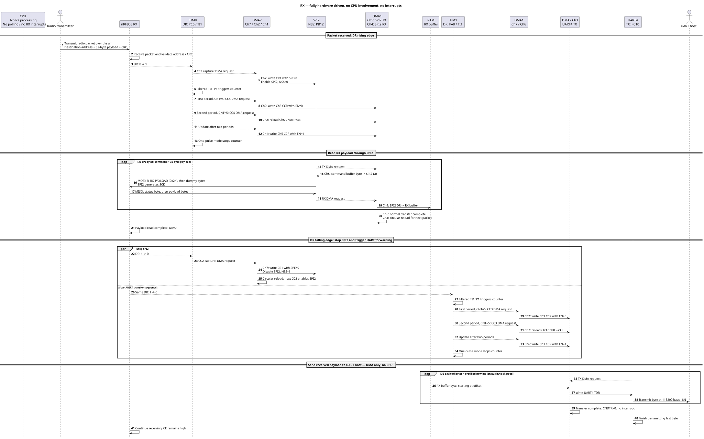
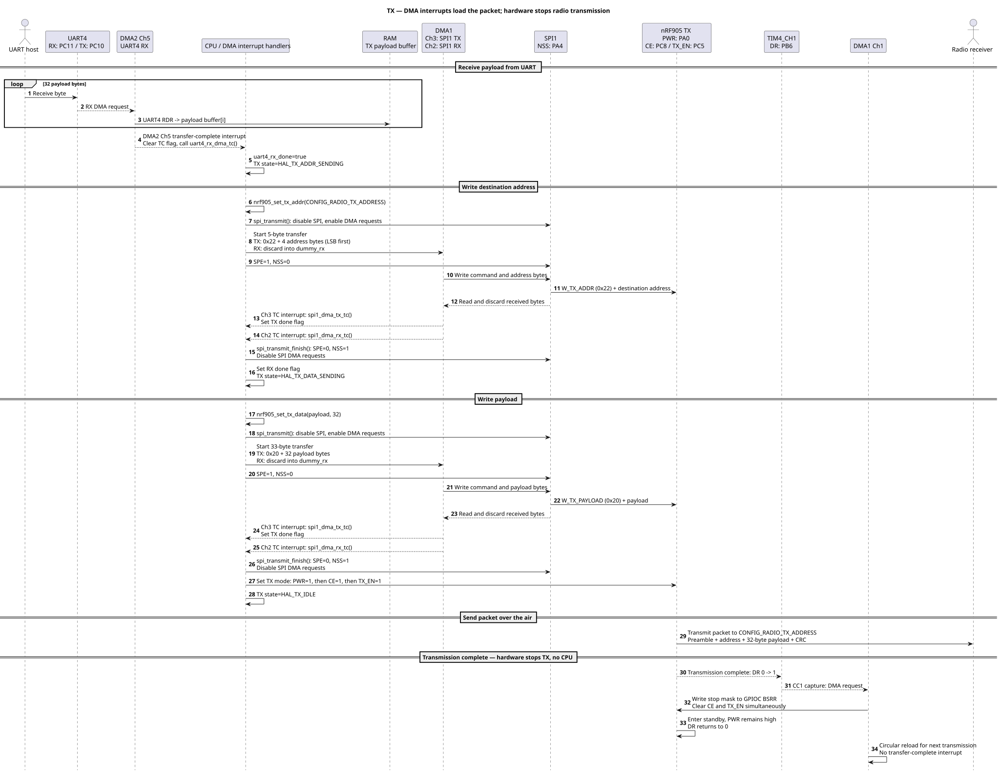

# nRF905 STM32L4 Transceiver

433 MHz radio transceiver based on nRF905 and STM32L476.

## Capabilities

* One code base for transmitter and receiver
* Pure hardware-driven architecture for receiver (no main loop nor interrupts)
* Custom, fixed size framre structure
* Communication with PC over UART
* Bare metal architecture, no OS, based on custom low level peripheral drivers
* Timers and DMA handle the entire RX data path without CPU involvement

## Firmware architecture

### RX

After initialization, reception and forwarding to UART are entirely hardware driven, with no CPU involvement, polling or interrupts.



### TX

DMA interrupts advance address and payload loading. TIM4 and DMA stop radio transmission without CPU involvement.



PlantUML sources: [RX and TX sequences](docs/rx_tx_sequence.md).

### Low-power sleep

The system and APB clocks use MSI at 2 MHz, with voltage scaling Range 2 and the main PLL disabled. UART4 uses the independent HSI16 clock to retain 115200 baud. SPI1/SPI2 retain the /16 prescaler, giving a 125 kHz SPI clock.

`hal_init()` selects the low-power regulator once, so the application runs in Low-power run. `hal_sleep()` executes WFI with SLEEPDEEP and SLEEPONEXIT cleared. DMA, SRAM, GPIO, TIM1/TIM4/TIM8, SPI1/SPI2 and UART4 clocks remain enabled during Low-power sleep. HSIKERON keeps the independent UART kernel clock enabled. After wakeup, the application remains in Low-power run; the regulator and system clock are unchanged.


### DMA channel allocation

Allocation for hardware version `v0.0.1`, with both transmitter and receiver enabled. Request numbers are the channel selections in `DMA_CSELR`.

| Controller | Channel | Status | Request source | Request selection | Purpose |
| --- | --- | --- | --- | --- | --- |
| DMA1 | Ch1 | Used (TX) | TIM4_CH1 | 6 | Clear radio TX CE and TX_EN through GPIOC BSRR on the rising DR edge |
| DMA1 | Ch2 | Used (TX) | SPI1_RX | 1 | Receive SPI1 bytes; completion interrupt advances the TX sequence |
| DMA1 | Ch3 | Used (TX) | SPI1_TX | 1 | Write the destination address and payload to the TX radio |
| DMA1 | Ch4 | Used (RX) | SPI2_RX | 1 | Read status and payload into the RX buffer using circular DMA |
| DMA1 | Ch5 | Used (RX) | SPI2_TX | 1 | Send R_RX_PAYLOAD and dummy bytes to clock out the received payload |
| DMA1 | Ch6 | Used (RX) | TIM1_UP | 7 | Enable DMA2 Ch3 after the UART TX channel has been rearmed |
| DMA1 | Ch7 | Used (RX) | TIM1_CH3 | 7 | Disable DMA2 Ch3 and reload its transfer count to 33 |
| DMA2 | Ch1 | Used (RX) | TIM8_UP | 7 | Enable DMA1 Ch5 after the SPI2 TX channel has been rearmed |
| DMA2 | Ch2 | Used (RX) | TIM8_CH4 | 7 | Disable DMA1 Ch5 and reload its transfer count to 33 |
| DMA2 | Ch3 | Used (RX) | UART4_TX | 2 | Send the 32-byte received payload and newline to the host |
| DMA2 | Ch4 | Free | — | — | Not allocated |
| DMA2 | Ch5 | Used (TX) | UART4_RX | 2 | Receive 32-byte payloads from the host using circular DMA |
| DMA2 | Ch6 | Free | — | — | Not allocated |
| DMA2 | Ch7 | Used (RX) | TIM8_CH2 | 7 | Alternate SPI2 enable/disable writes on rising/falling DR edges |

**Used: 12 of 14 channels. Free: DMA2 Ch4 and DMA2 Ch6.** All DMA1 channels are allocated. The RX data path uses no DMA interrupts after initialization; TX uses completion interrupts for UART4 RX and SPI1 RX/TX.

With `CONFIG_TRANSMITTER_EN=OFF`, DMA1 Ch1–Ch3 and DMA2 Ch5 are unused. With `CONFIG_RECEIVER_EN=OFF`, DMA1 Ch4–Ch7 and DMA2 Ch1–Ch3/Ch7 are unused by the radio path. UART request selections are still assigned during initialization; a request selection alone does not enable a DMA channel.

## Tools

* CMake 3.20.0
* Ninja 1.11.1 
* Arm GNU Toolchain 13.2.rel1 (Build arm-13.7) 13.2.1 20231009
* SEGGER J-Link Software V7.96k
* OpenOCD v0.12.0-i686-w64-mingw32 (optional)
* STSW-LINK009 v2.0.2 (optional)

## External libraries

* CMSIS_5 5.9.0
* cmsis_device_l4 v1.7.2

## Build

### Generate ninja files
`cmake --preset <hw_version>_<config>`

### Build project
`cmake --build --preset <hw_version>_<config>`

## Radio configuration

Radio settings are CMake cache variables defined in the root `CMakeLists.txt`.
Override them when configuring the project with `-DNAME=value`:

| Variable | Default | Meaning |
| --- | --- | --- |
| `CONFIG_RADIO_RX_ADDRESS` | `0xDDCCBBAAUL` | Receive address |
| `CONFIG_RADIO_TX_ADDRESS` | `CONFIG_RADIO_RX_ADDRESS` | Transmit address; follows the receive address unless overridden |
| `CONFIG_RADIO_CHANNEL` | `108` | Channel number (0?511) |
| `CONFIG_RADIO_BAND` | `NRF905_PLL_FREQ_433_MHZ` | Band: `NRF905_PLL_FREQ_433_MHZ` or `NRF905_PLL_FREQ_868_915_MHZ` |
| `CONFIG_RADIO_TX_POWER` | `NRF905_PA_PWR_10_DBM` | Power: `NRF905_PA_PWR_MINUS_10_DBM`, `NRF905_PA_PWR_MINUS_2_DBM`, `NRF905_PA_PWR_6_DBM` or `NRF905_PA_PWR_10_DBM` |

```sh
cmake --preset v0.0.1_debug -DHAL_RADIO_CHANNEL=110 -DHAL_RADIO_RX_ADDRESS=0xAABBCCDDUL -DHAL_RADIO_TX_POWER=NRF905_PA_PWR_6_DBM
cmake --build --preset v0.0.1_debug
```

Values persist in the build directory's CMake cache. Reconfigure and rebuild after changing them.

`CONFIG_TRANSMITTER_EN` and `CONFIG_RECEIVER_EN` are independent ON/OFF options, both ON by default. They include or exclude the respective radio initialization, SPI/DMA callbacks, buffers and radio functions. Public HAL functions remain available and do nothing when their radio is disabled. Loopback tests run only with both options enabled. With the transmitter disabled, the main loop does not wait for UART messages.
