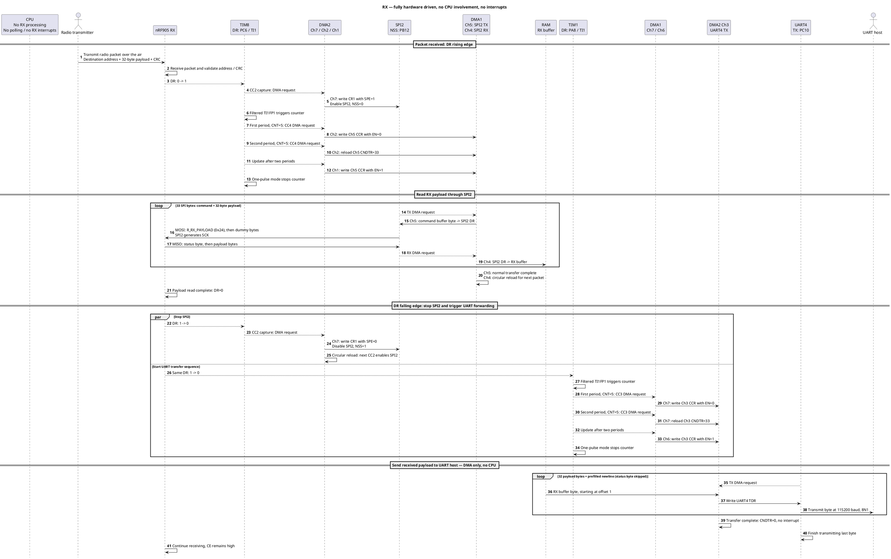
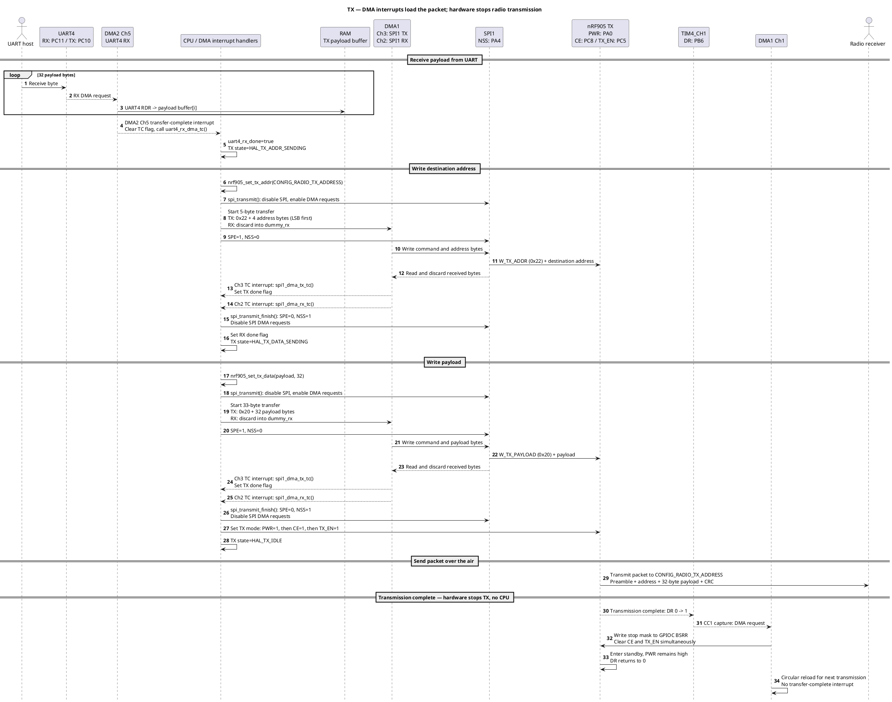

# RX

After initialization, reception and forwarding to UART are entirely hardware driven: **no CPU execution, no polling, no interrupts**.

# TX

UART reception and SPI transfers use DMA interrupts to advance the TX sequence. Radio transmission completion stops TX through TIM4 and DMA without CPU involvement.

